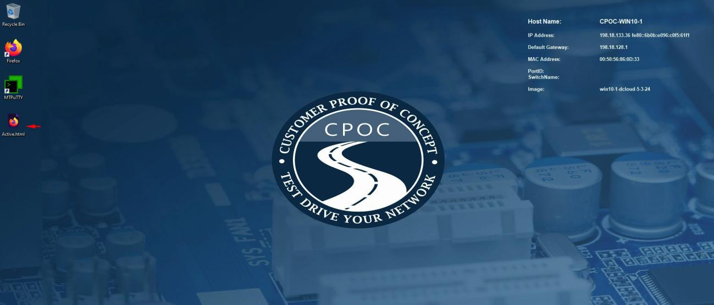
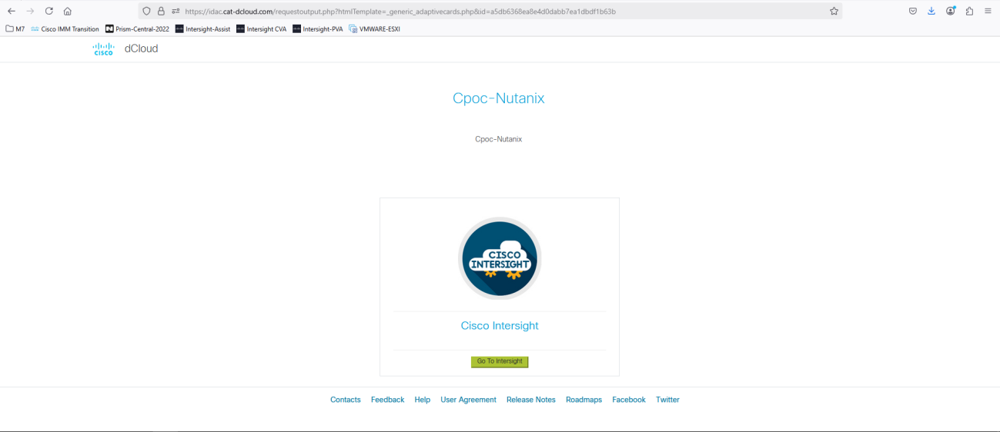
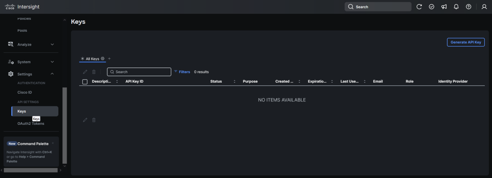
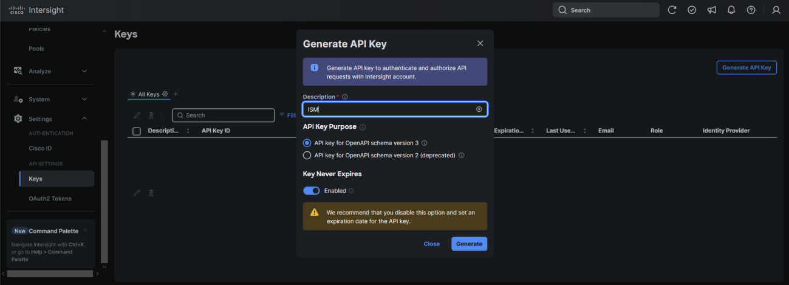
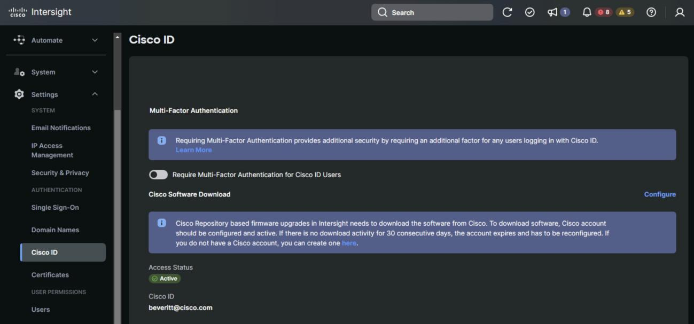

# Scenario 2 · Cisco Intersight API Key Generation

1. On the Desktop click the Active.html icon to access the Intersight login, on the next page click the hyperlink “Click here to login”.

2. In the resulting window click Go to Intersight; this will log you in automatically.

!!! note
    If you need to access Intersight from cpoc-win10-2, copy the URL and paste it into the browser on the second Windows virtual machine, then click Go to Intersight

3. On the left side of Intersight, under Settings, click Keys
4. Click “Generate API key” using schema version 3 for use by Nutanix Foundation Central. Be sure to save the Secret Key to a file. It will only be shown once.

5. Save the API Key ID and Secret Key on the Desktop.
6. Ensure your Cisco ID is granted access to download software from CCO. If not, click the Activate link and enter your CCO login credentials. This step is not required for an air-gapped Cisco Intersight private Virtual Appliance (PVA).

