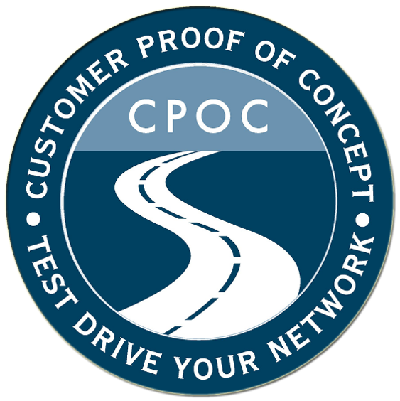

# Cisco Unified Edge

*Cisco Global Demo Engineering Customer Proof of Concept*

**Author:** Esteban Arguedas (eargueda@cisco.com) · **Version:** 1.0 · **Last updated:** 1 October 2026

<!-- pdf:skip:start -->
[Download this guide as PDF](#){ .cpoc-btn data-pdf-guide="unified-edge" }
<!-- pdf:skip:end -->

!!! note "Document status"
    All printed copies and duplicate soft copies of this document are considered uncontrolled. Please refer to the original, online document link for the current version.

## About this CPOC

Cisco Unified Edge with Nutanix is a joint, software-defined infrastructure platform designed to extend data center compute, networking, security, and storage directly to edge locations.
By marrying Cisco’s edge-optimized hardware and cloud-management SaaS with Nutanix’s enterprise-grade hyperconverged and cloud-native software stack, this joint architecture solves the core challenge of managing distributed, remote edge locations at scale without requiring dedicated on-site IT staff.

## Scope

### Goals

After completing these scenarios, you will know how to claim, deploy and configure the Nutanix cluster with Cisco Intersight.

## What you'll do

| Scenario | Description |
|---|---|
| [Scenario 1](scenario-1.md) | Configure Hardware Provider|
| [Scenario 2](scenario-2.md) | Nutanix Cluster Deployment with AHV or ESX Hypervisor|
| [Scenario 3](scenario-3.md) | Initial Cluster Configuration|
| [Scenario 4](scenario-4.md) | Witness VM Installation and Configuration (Optional)|

See the [Environment](environment.md) page for lab IP addresses, credentials and equipment, and [Get Started](getting-started.md) to begin.

## Disclaimer

Test results are suitable to the specific design, configuration, test procedure, and types of switches deployed in the environment described in this document.

This document is provided "As-Is," without warranty of any kind, express or implied, including without limitation those of merchantability, fitness for a particular purpose, and non-infringement arising from a course of dealing, usage, or trade practice.

All printed copies and duplicate soft copies are not considered controlled; therefore, please refer to the original online version for the latest version.

### Document history

| Revision | Date | Author | Description | Version |
|---|---|---|---|---|
| 1 | 1 October 2026 | Arguedas | Intersight – Nutanix UE use cases | 1.0 |

<!-- pdf:skip:start -->

[Start the Lab](getting-started.md){ .cpoc-btn }
[Convert to PDF](#){ .cpoc-btn .cpoc-btn--outline data-pdf-guide="unified-edge" }

