# Scenario 1 · Configure Hardware Provider

This scenario guides you through adding the hardware provider.

On the Desktop click the Active.html icon to access the Intersight login, on the next page click the hyperlink “Click here to login”.

  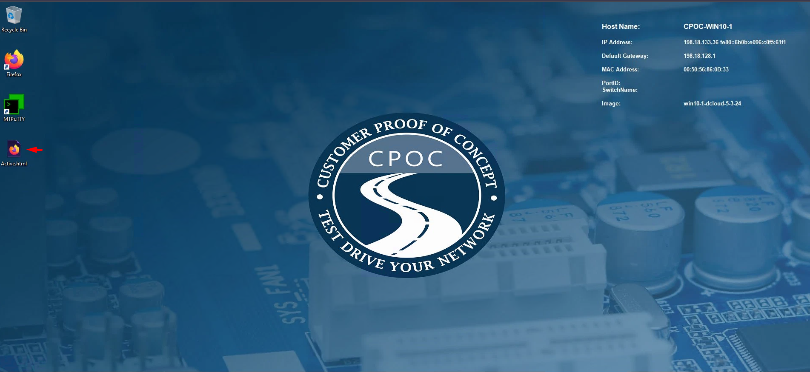

In the resulting window click Go to Intersight; this will log you in automatically.

!!! note
    If you need to access Intersight from cpoc-win10-2, copy the URL and paste it into the browser on the second Windows virtual machine, then click Go to Intersight

 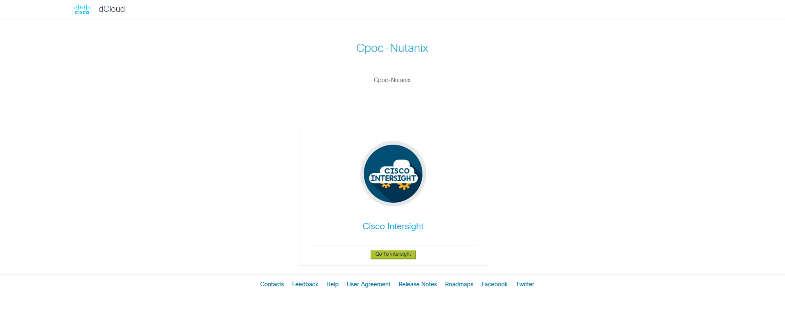

On the left side of Intersight, under Settings, click Keys
Click “Generate API key” using schema version 3 for use by Nutanix Foundation Central. Be sure to save the Secret Key to a file. It will only be shown once.

 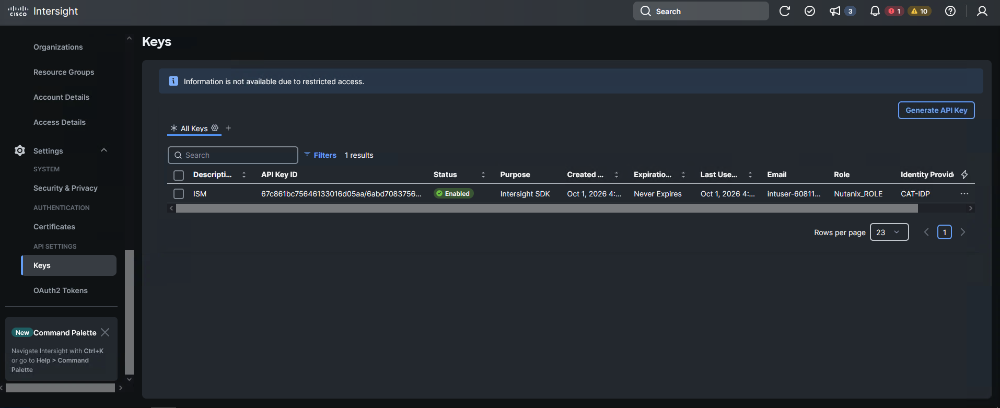

 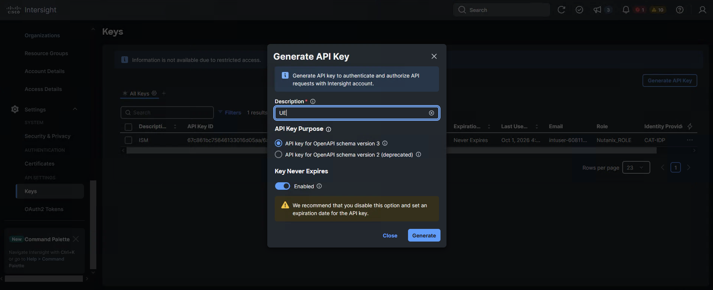

Save the API Key ID and Secret Key on the Desktop.

In the bookmarks bar at the top, click Foundation Central 2.2

 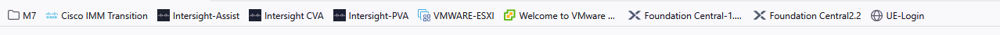

Open the Foundation Central Appliance VM GUI using a web browser at `https://<FC_IP>:9440`
Log in as the user “admin” using the password C1sco12345!

 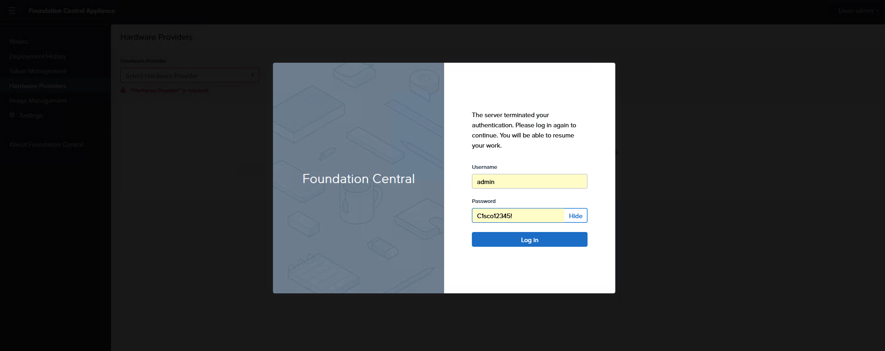

Click Hardware Providers on the left. Select Cisco Intersight from the dropdown list, then click Create Cisco-Intersight
Connection.

 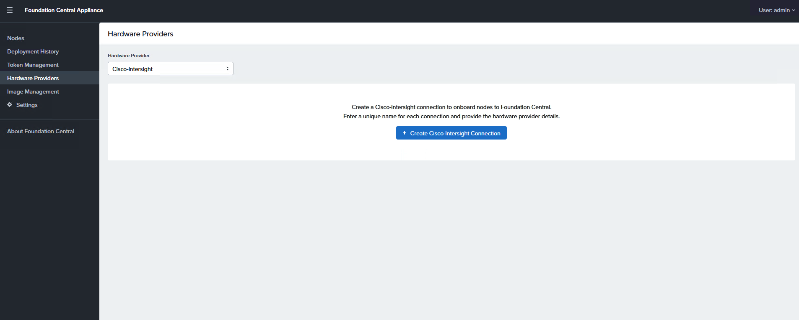

Give the connection a name, then select the deployment type; either SaaS (in the cloud) or a local CVA/PVA, then
click Next.

 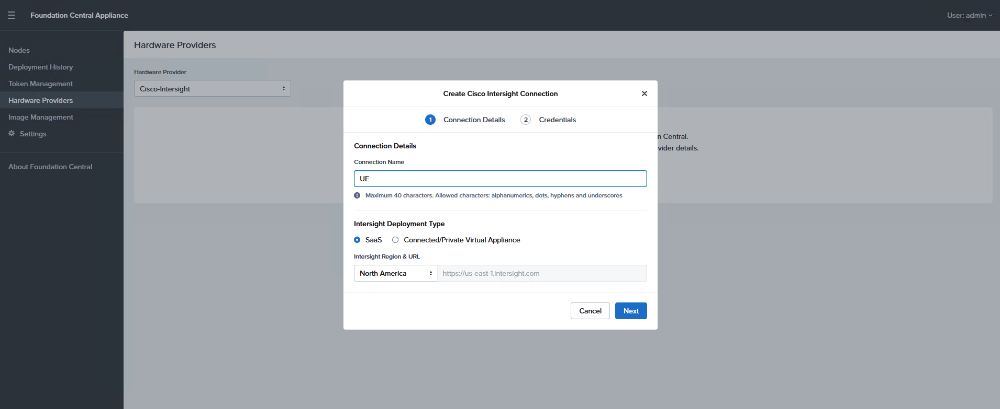

Enter the API Key ID and Secret
Key for Cisco Intersight SaaS or the CVA/PVA being used. Once the connection is saved successfully, nodes can be onboarded.

 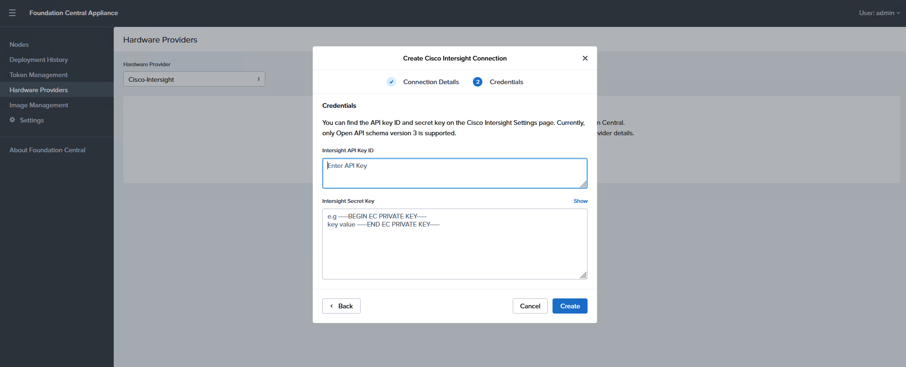

Click Image Management on the left and then click Upload Image.
    
 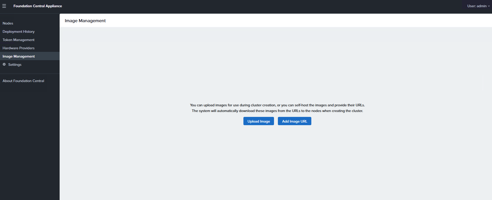
    
Where to get the images?

 

Log in to the Cisco IMM Transition tool (use the bookmark). In the application, click Software Repository; you will see folders for different versions. For this deployment you can select a Nutanix AOS version and a hypervisor supported by the servers. Check the versions and select the one you want to deploy, using AOS with the AHV hypervisor, or see below for the VMware ESXi options.

 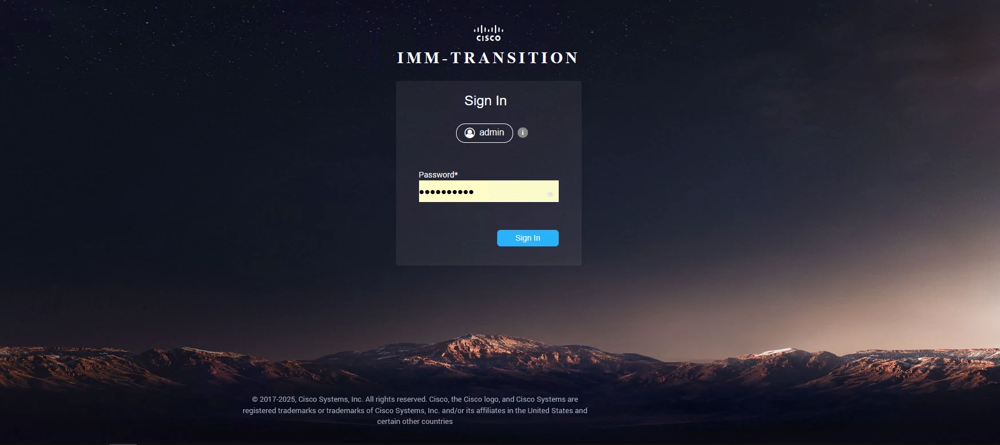

Choose one of the options to deploy the new cluster, access the desired folder and download the AOS and AHV images: click the ellipsis on the right side, then select Download.

 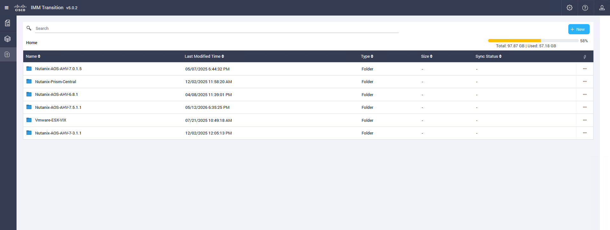
  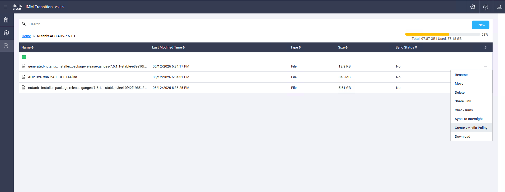

Return to Foundation Central and Select the
image type of AOS or Hypervisor and give the image a name. Select the
image file, metadata JSON or checksum then click Upload Image. Repeat the
process until a supported AOS software installer and an AHV hypervisor
installer are both uploaded.

 
 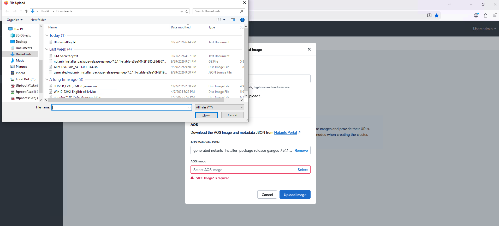

You’ll need to generate the checksum from the IMM Transition tool for the hypervisor OS.

 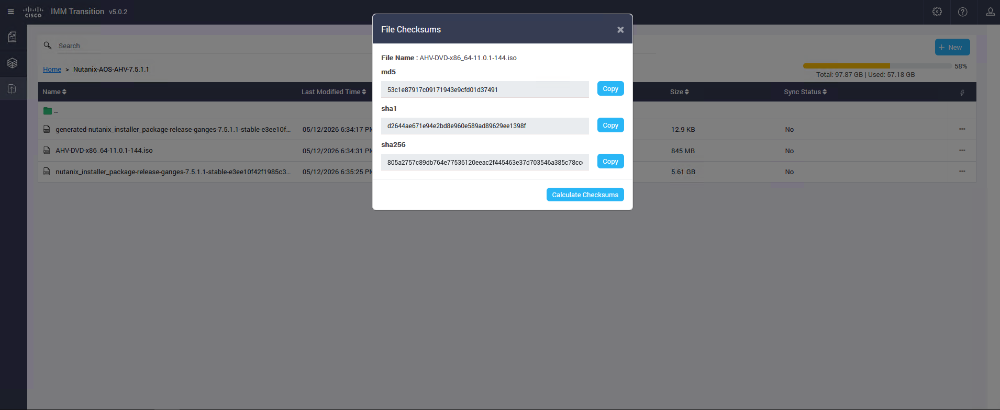
 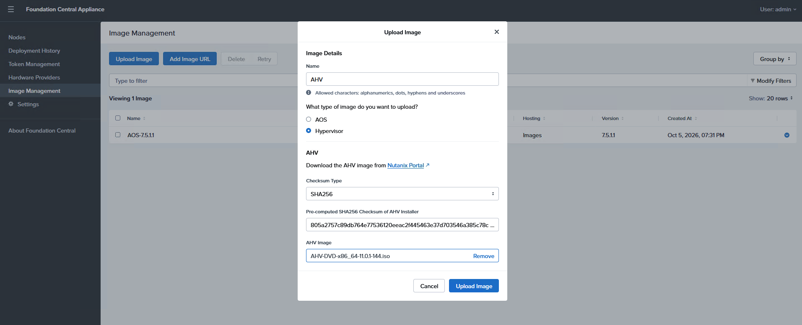

Once both are loaded, the page should look like this example:
 
 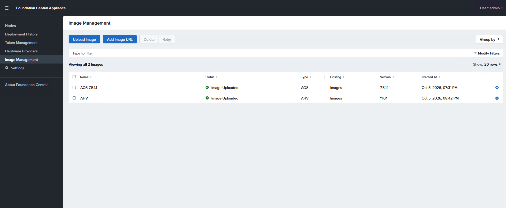

Click Nodes on the Left then click Onboard Nodes. 

  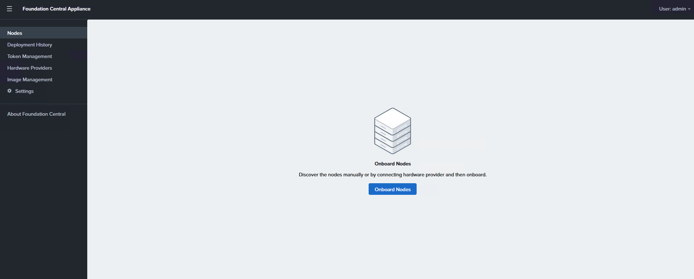

Select to onboard Via Hardware Provider, then select Cisco-Intersight from the dropdown list. Select the Intersight Connection where the new nodes for the cluster are managed, then click Next.

 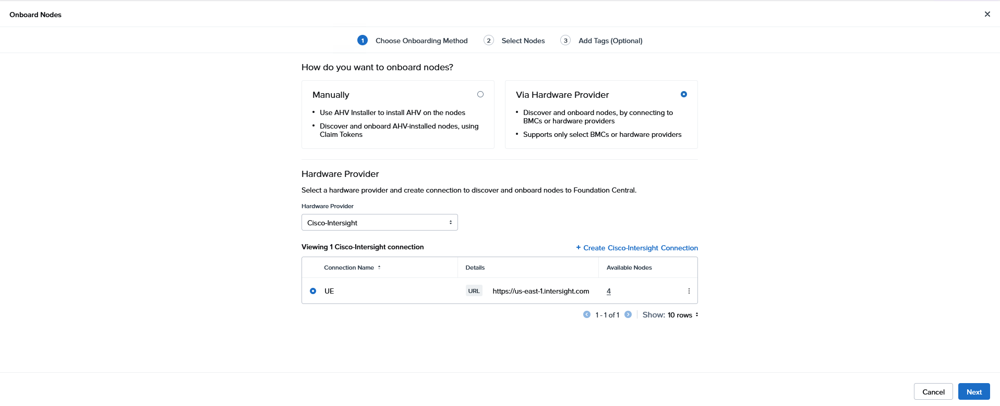

Select all nodes on the left side and click Next, then click Onboard Nodes.

 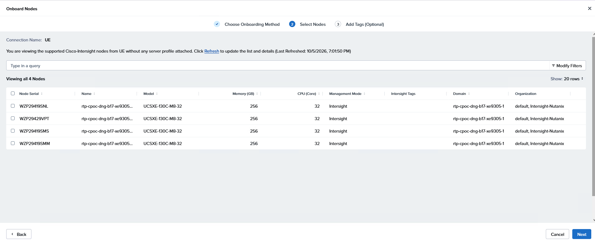
 
Once the nodes are onboarded, you’ll see an example like this:

 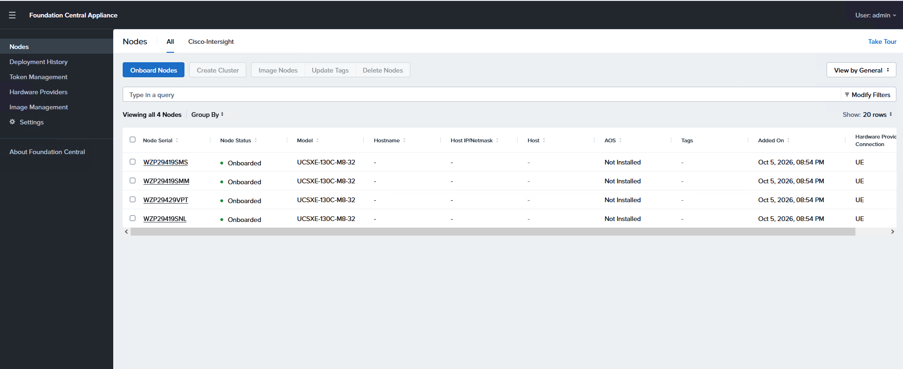
