# Scenario 2 · Nutanix Cluster Deployment with AHV or ESX Hypervisor

In Foundation Central under Nodes select the first 3 nodes you would like to use for the cluster deployment and click Create Cluster.

  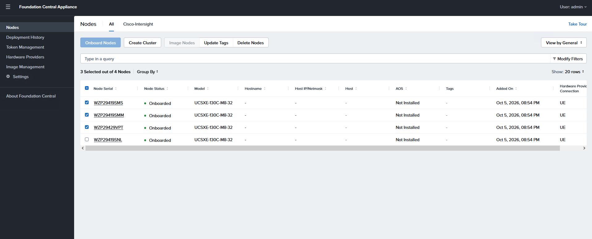

Enter the required information and click Next

- Name = UE
- Intersight Organization= Intersight-Nutanix

 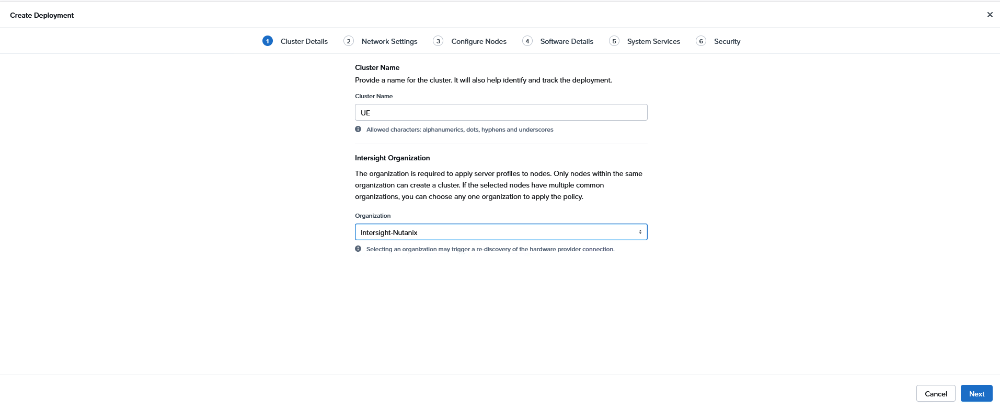

Fill in the networking information:

- Gateway = 198.18.128.1
- Netmask = 255.255.192.0
- Cluster Virtual IP = 198.18.137.2
- Host and CVM VLAN = 10
- Click Next

 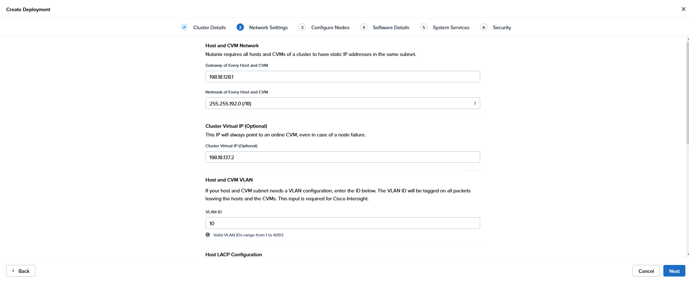
 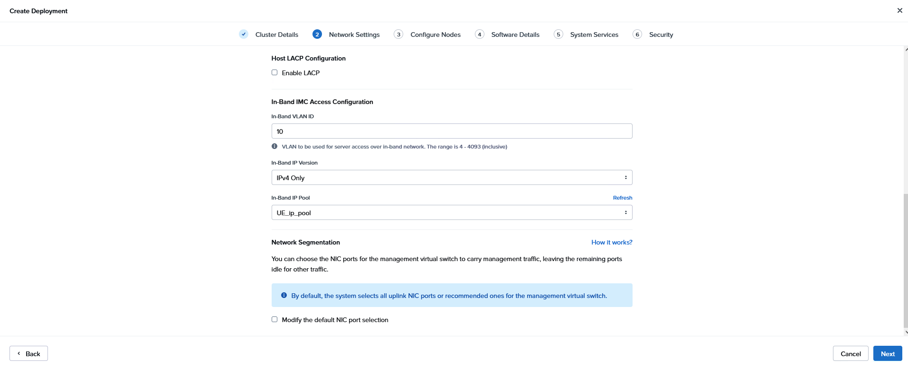

To complete the cluster Host IP, CVM IP and Host name use the image below as an example, you can choose any IP address from 198.18.137.20 up to 198.18.137.100.
When adding the Host IP, skip one IP address between Host IP and CVM IP.

 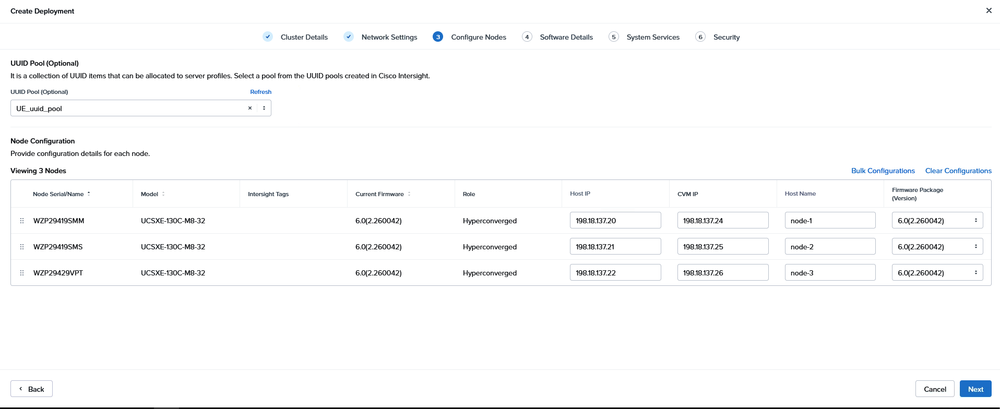

Choose to image the servers with a new version of AOS and AHV, unless the servers have been prepared at the factory with pre-installed software.

Select the AOS image and AHV image uploaded earlier, then click Next.

 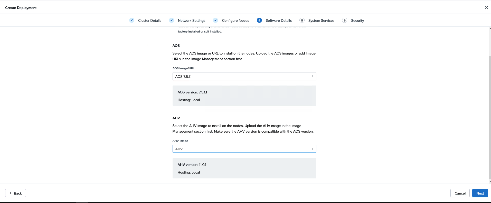

For Cluster Fault Tolerance, select 1N/1D. For CVM Settings, use the following information:

- Timezone= America/New_York
- NTP=198.18.128.1
- DNS= 198.18.133.1
- Click Next

 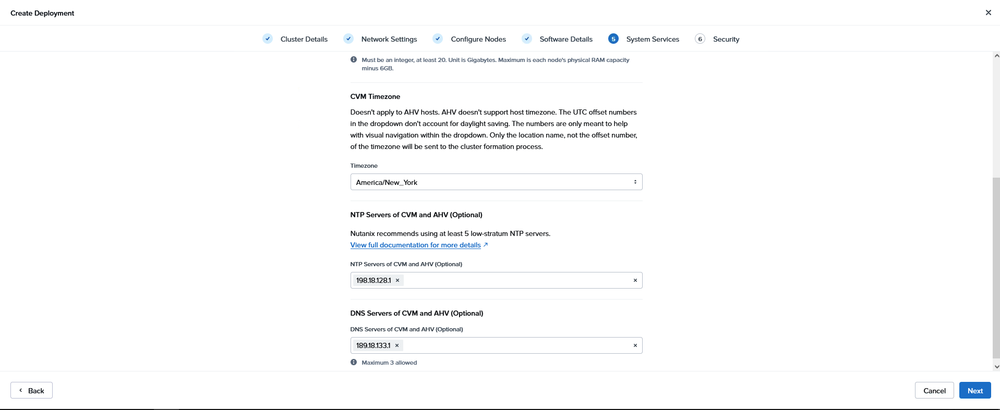

Enter a new default password for the cluster (C1sco12345!), confirm it, and then click Create Deployment.

 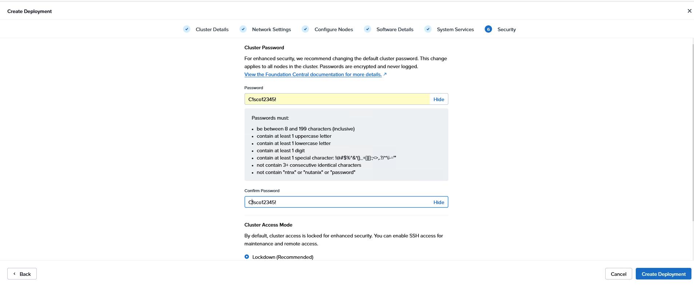

The cluster deployment has begun. Click the In Progress link to see more information about the deployment and expand each phase for
additional details. Deployments without firmware upgrades/downgrades typically take 60-90 minutes to
complete. With firmware upgrades/downgrades it is common to take an additional 60-90 minutes.

 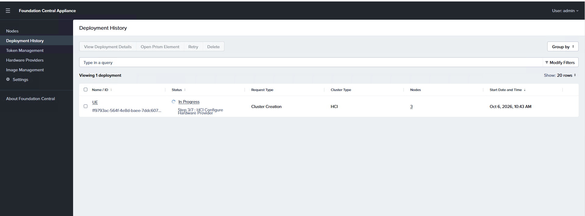
 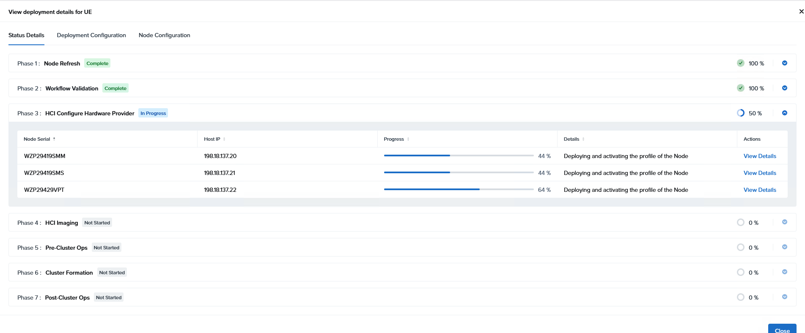

Return to Intersight, under Operate select Servers to check the Server Profile provisioning progress.

  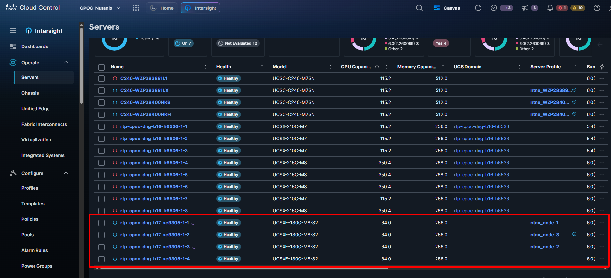

A successful installation looks like this example:

  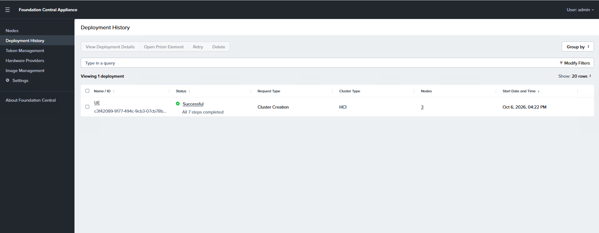