# Scenario 3 · Initial Cluster Configuration

This scenario will take you to the initial configuration required for the cluster

On the newly created cluster, click Deployment Configuration; you will see the Cluster VIP 198.18.137.2.

  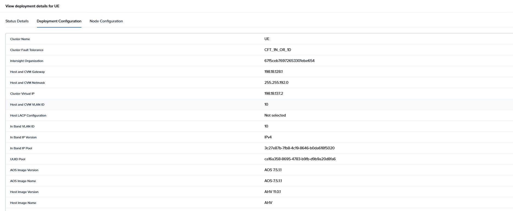

Open a new tab and log in to the new Prism at 198.18.137.2 (admin / nutanix/4u).
You must create a new password; use C1sco12345!

  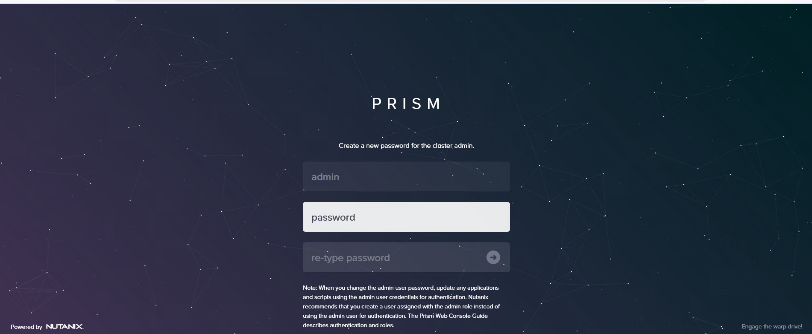

For the Nutanix EULA, fill in the information, check the box, and click Accept and Continue:

- Name= cpoc
- Company= Cisco
- Job title= UE

 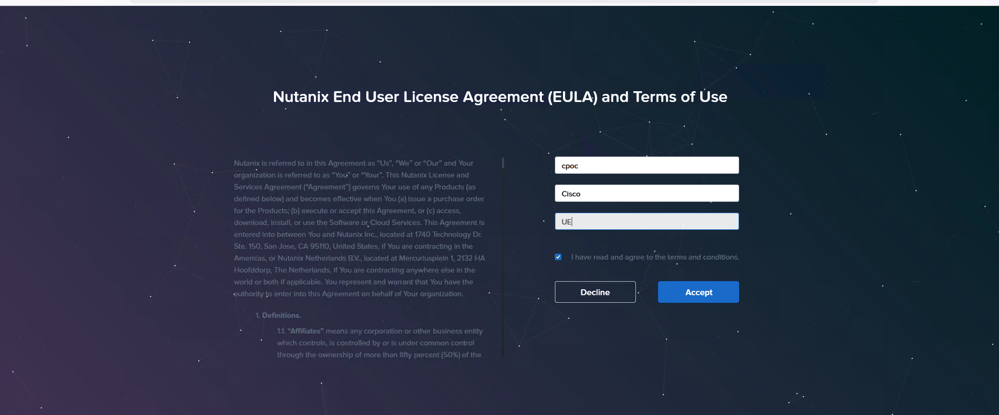

Click Home at the top, select Storage, then click + Storage Container.

  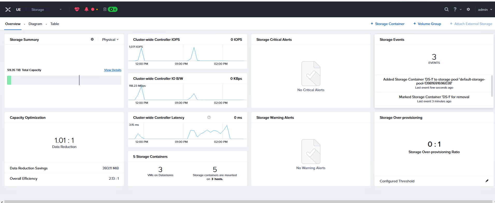

Add the name DS-1, click Advanced Settings, and under Reserved Capacity enter 1000 GB (the same as the Advertised Capacity), then click Save.

  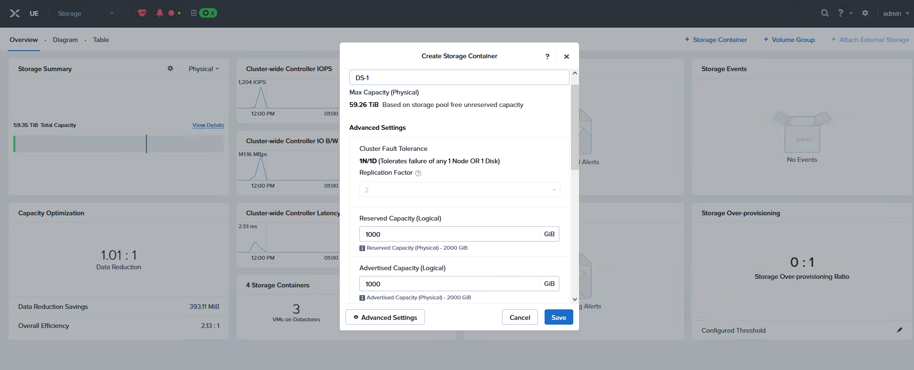

Click Table to view the new DS-1 storage.

  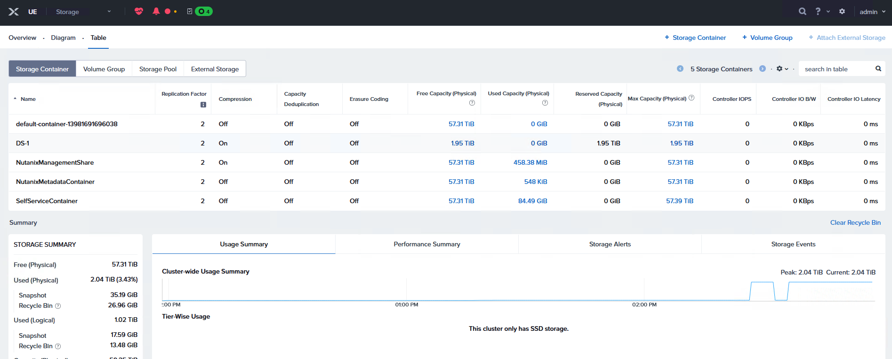

From the top drop-down menu, select Settings and click Rebuild Capacity Reservation.

!!! note
    Without this setting enabled, the cluster will accept incoming writes even if all blocks cannot completely heal during failures.

    After enabling it, the cluster will refuse new writes if they cannot be fully protected during failures.

  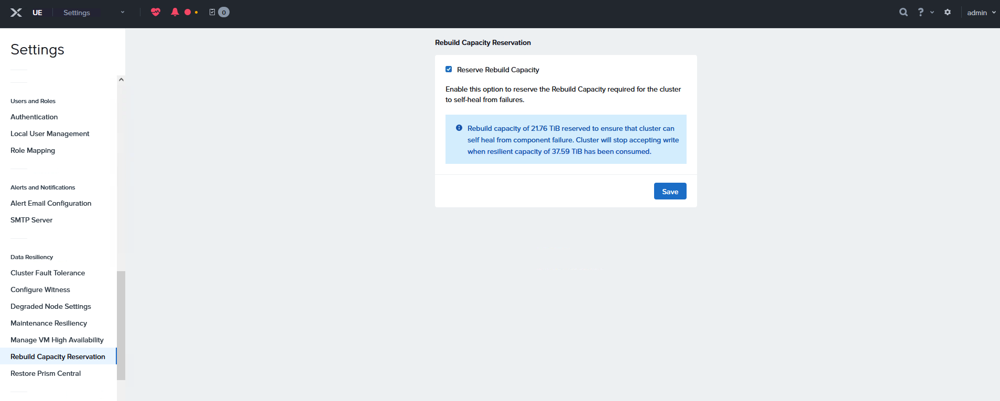

In the same Settings menu, scroll up, click Cluster Details, add the Data Service IP 198.18.137.3, and save.

 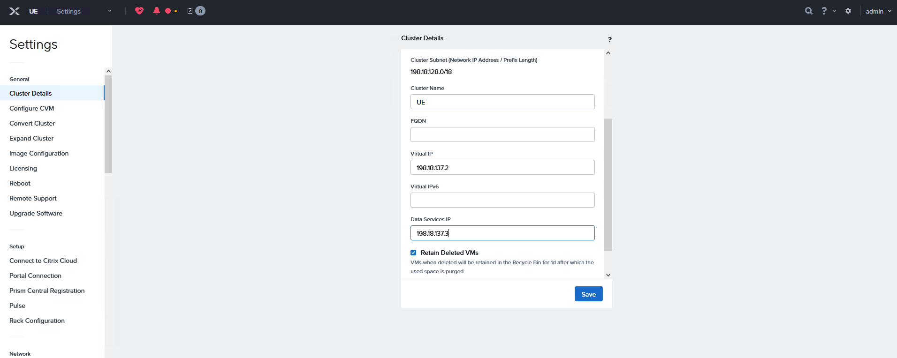

Then scroll down to Manage VM High Availability, check the box, save, and click OK.

  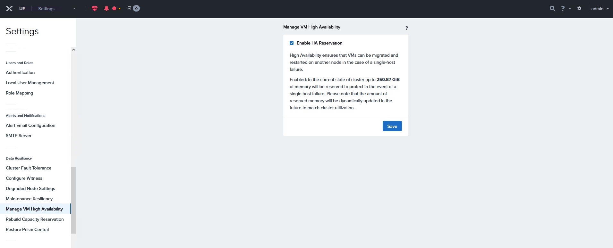

Remediate all NCC failures and warnings.

  

Go to Health, click Actions, and select Run NCC Checks.

  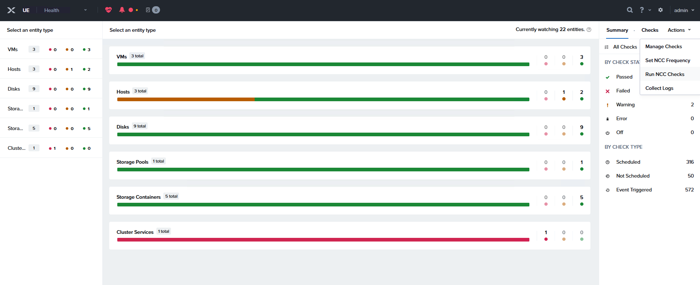
  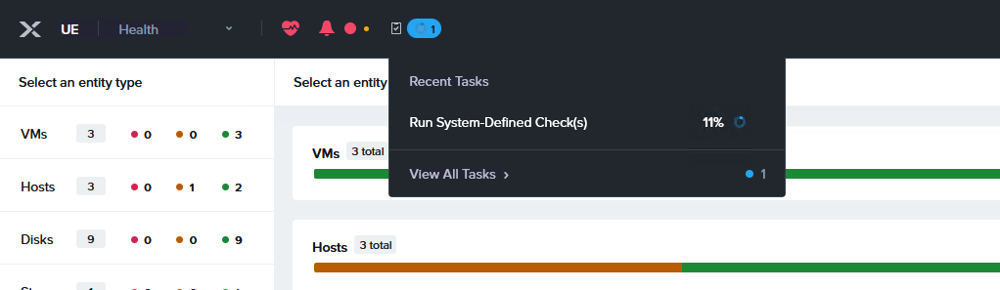

## Deploy and Register Cluster with Prism Central

These instructions assume the Prism Central
instance or cluster used to deploy the Nutanix
cluster will also be the one used long-term for
management. If not, deploy a new Prism Central
instance or cluster on the new Nutanix cluster, then
register that cluster with the Prism Central instance
running on itself.

