# Scenario 4 · Witness VM Installation and Configuration (Optional)

A Witness VM is highly recommended for 2-node clusters or clusters configured for Metro Availability.
The witness VM makes failover decisions during network outages or site availability interruptions to avoid split-brain
scenarios.
The witness VM must reside in a different failure domain from the clusters it is monitoring, meaning it has its own
separate power and independent network communication to both monitored sites.

Go to the Cisco IMM Transition tool (see the bookmark, or access 198.18.129.100, admin / C1sco12345), then select WitnessVM and download all the content.

 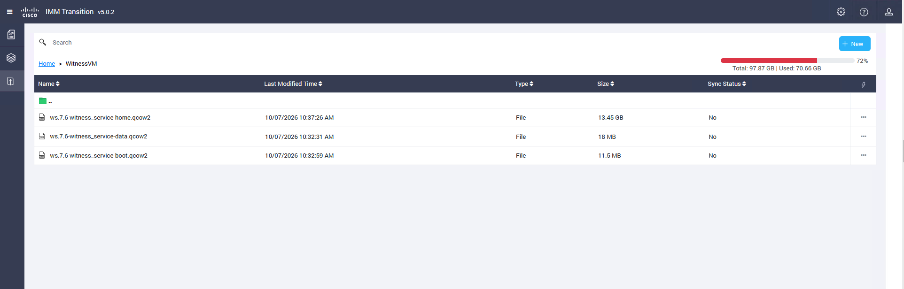

Return to the newly created cluster and click Deployment Configuration; you will see the Cluster VIP 198.18.137.2.

  

Open a new tab and log in to the new Prism at 198.18.137.2 (admin / nutanix/4u).
You must create a new password; use C1sco12345!

  

For the Nutanix EULA, fill in the information, check the box, and click Accept and Continue:

- Name= cpoc
- Company= Cisco
- Job title= UE

  

Click Home at the top, then select Settings, click Image Configuration, and then click + Upload Image.

  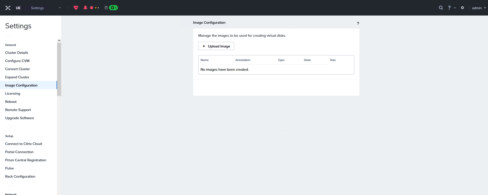

Fill in the information for the new image:

- Name= Witness VM boot
- Image Type = DISK
- Storage Container = SelfServiceContainer

Click Upload a file, click Browse, select the file, and click Save.

  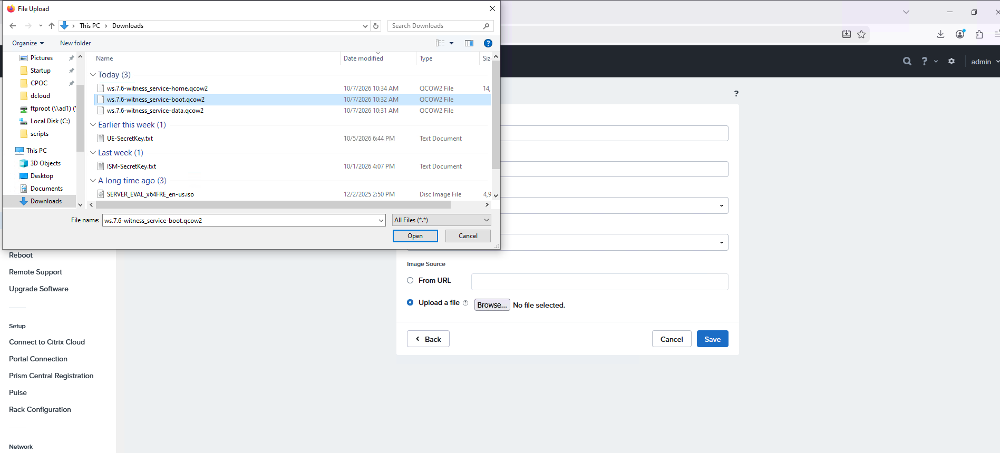

Repeat the steps to upload the data and home files.

  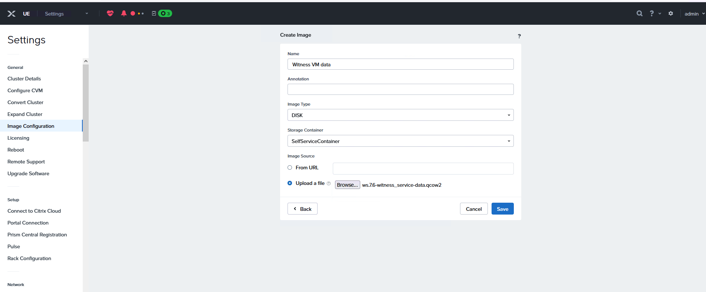
  
  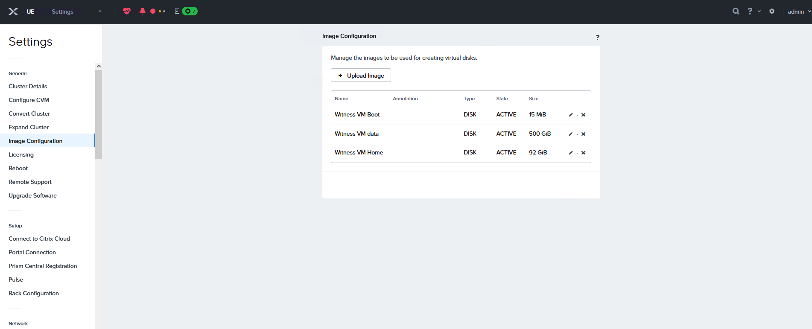

Deploy the Witness VM.
From the top drop-down menu, select VM, then click + Create VM.

  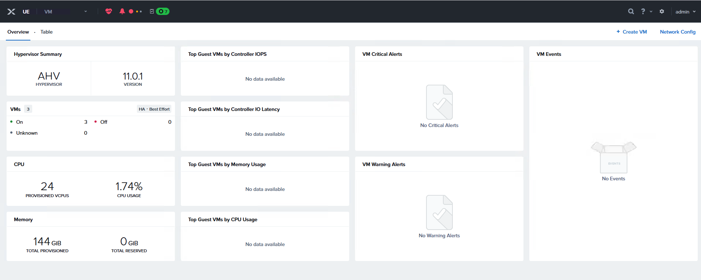

Add the name Witness_VM_AHV and 2 vCPUs.

  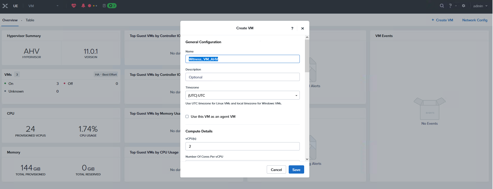

For memory, add 6 GB and select Legacy BIOS.

  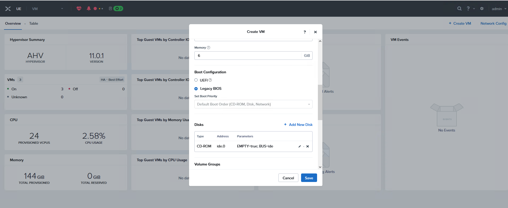

Add all three disk images as SCSI disks, cloned from the image service:

- First: Boot disk
- Second: Home disk
- Third: Data disk

  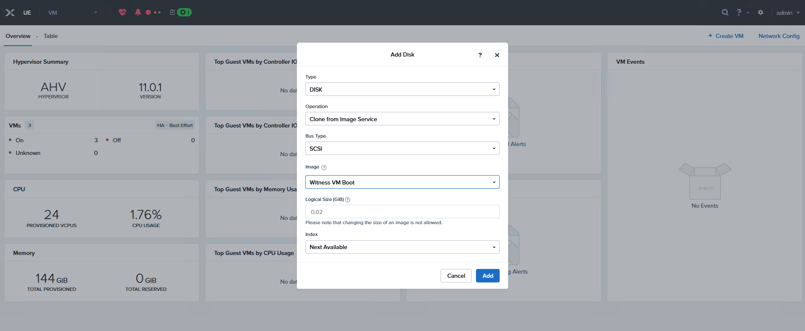
  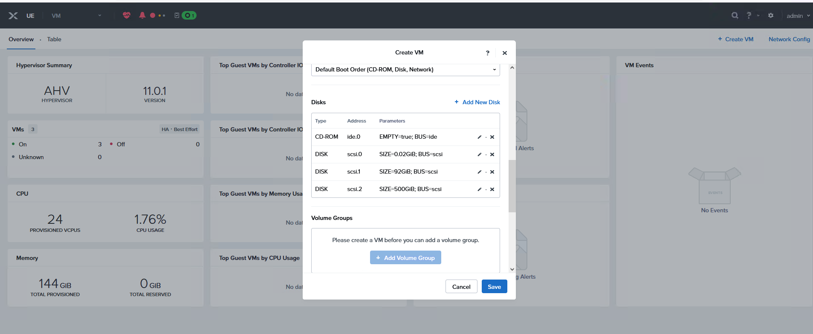

Now click + Add New NIC and select Add Network.

  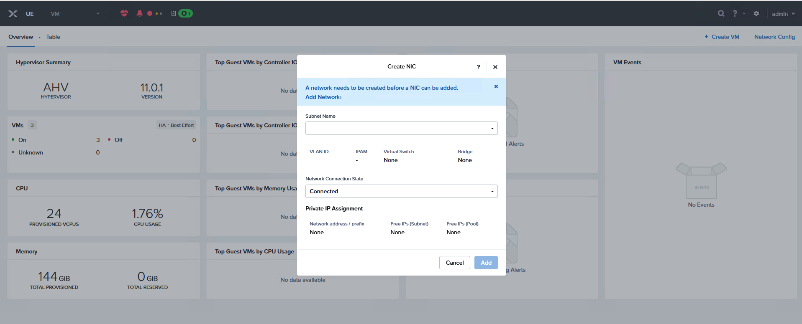

Create the subnet: Name VM_network, Virtual Switch vs0, VLAN ID 10, then click Save.

  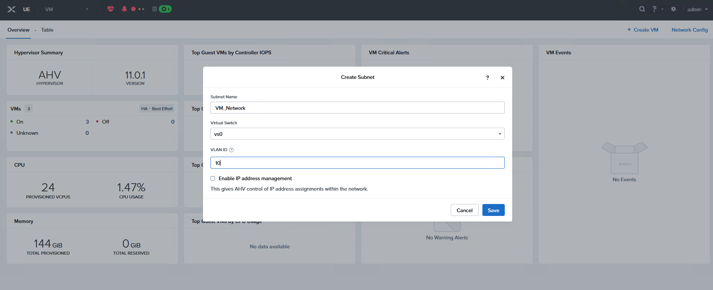

Click the X and the new subnet will be added to the new NIC, then click Add.

  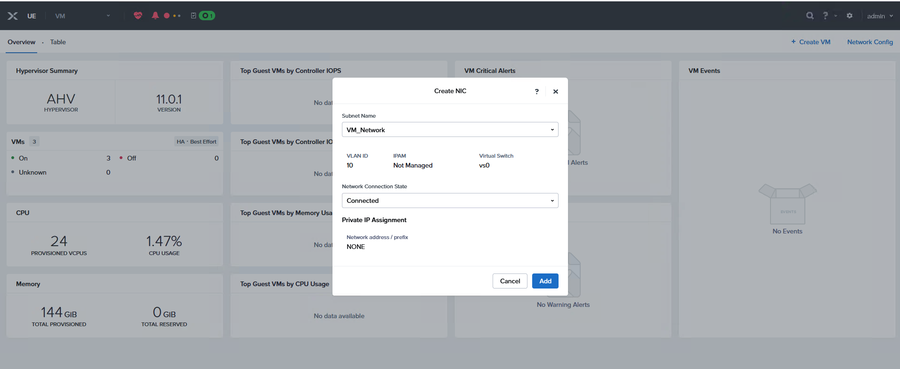

Now save the new VM.

  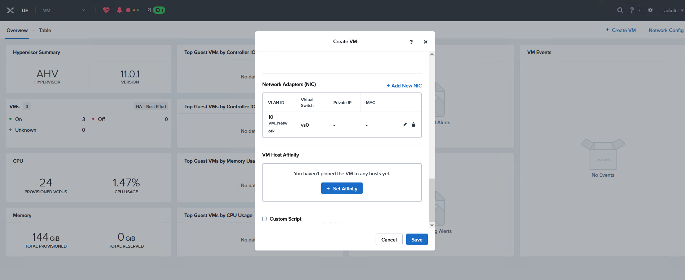

Click Table at the top left to view the new VM and power it on.
 
  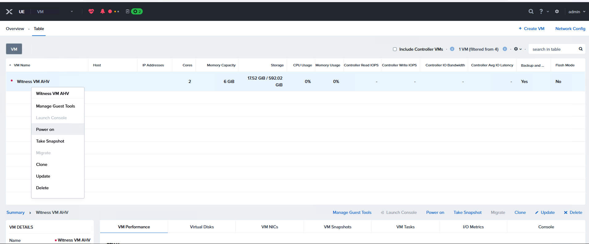

