# Scenario 5 Deploy and Register Cluster with Prism Central

These instructions assume the Prism Central
instance or cluster used to deploy the Nutanix
cluster will also be the one used long-term for
management. If not, deploy a new Prism Central
instance or cluster on the new Nutanix cluster, then
register that cluster with the Prism Central instance
running on itself.

Return to the main dashboard and click on Register or deploy new Prism Central

  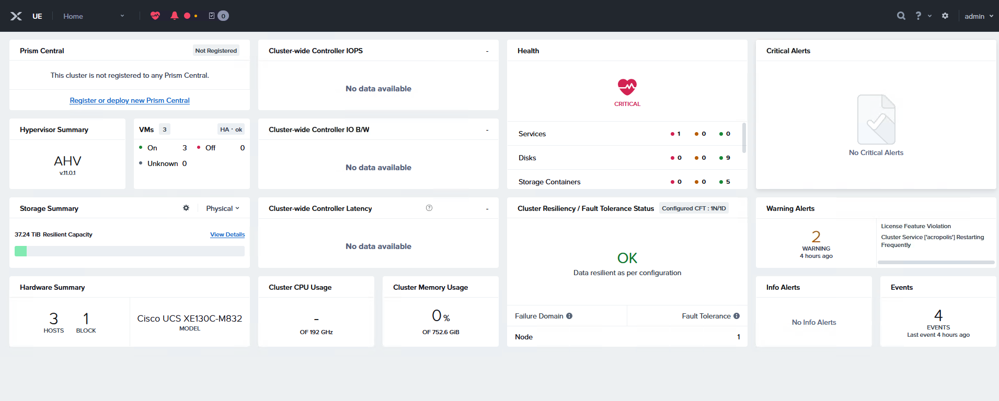

Click Deploy 

  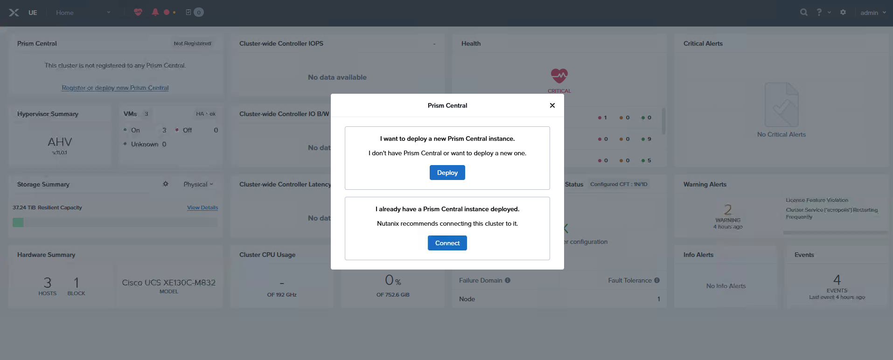

Add a PC name as pc7.5.1.1, then select pc.7.5.1.1 and click next

  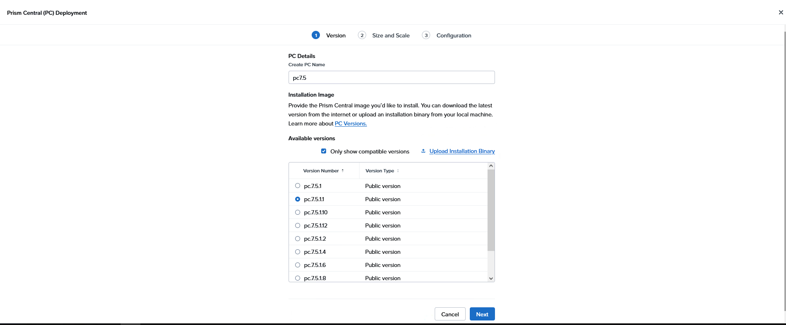

for the prism central size and scale, select Small and click next 

  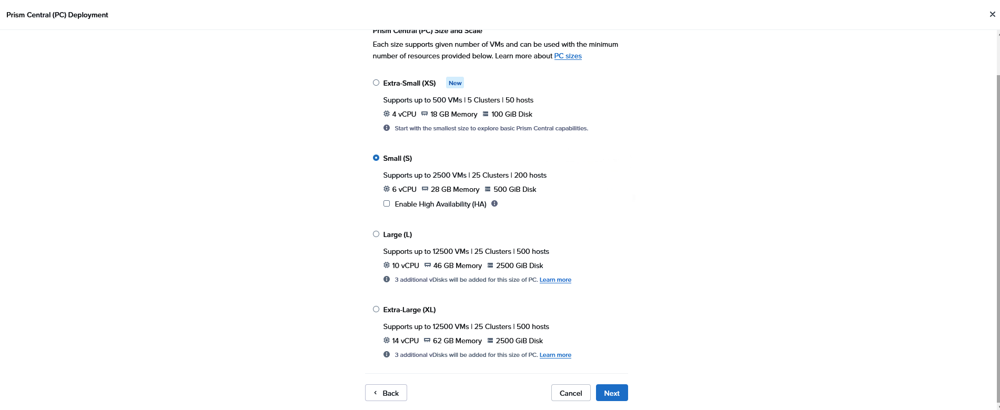

For netowrking details

Add Network information:

Network = select existing VM_Network
Subnet Mask = 255.255.192.0
Gateway IP = 198.18.128.1
DNS = 198.18.133.1
NTP = 198.18.128.1
Container = DS-1
Under General Details
IP Address= 198.18.137.4
Click Deploy

 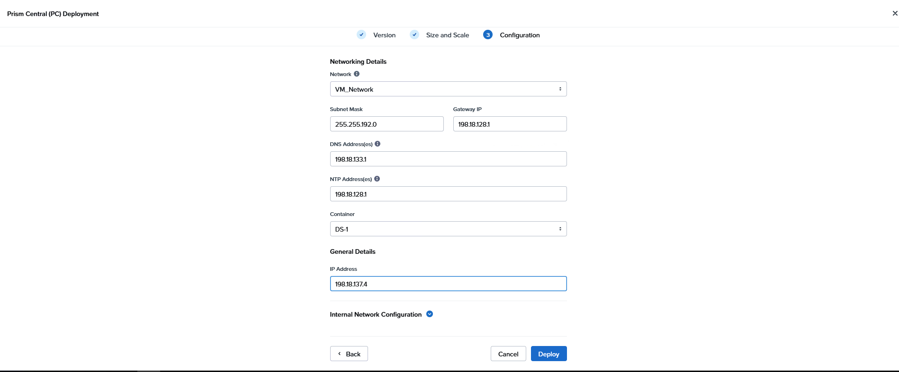

    Deployment can take 45+ minutes

Once the deployment begins it will take you back to the main dashboard and under the Prism Central widget you will see the deployment activity.

 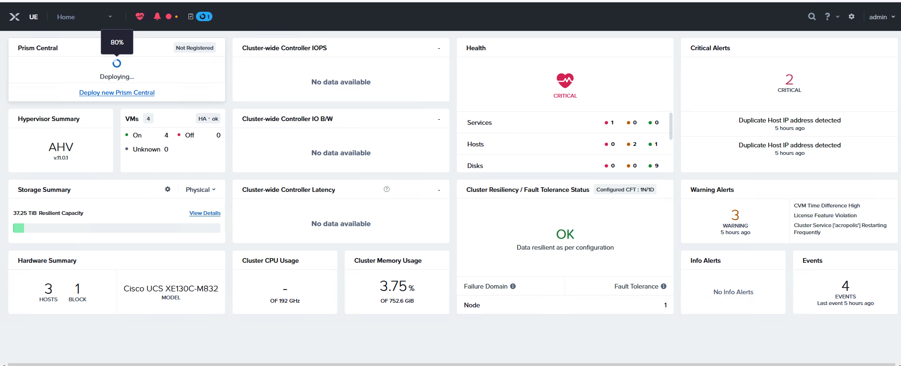

Once Prism Central deployment is completed, use a web browser to connect to the virtual IP assigned (198.18.137.4) and change the default password.

First time logging in the credentials are:
Username = admin
Password= Nutanix/4u

 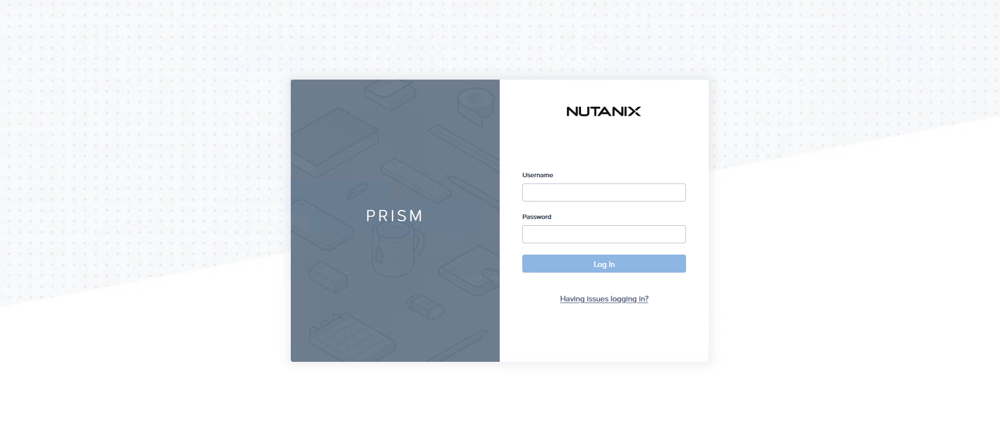

create a new password C1sco12345!

 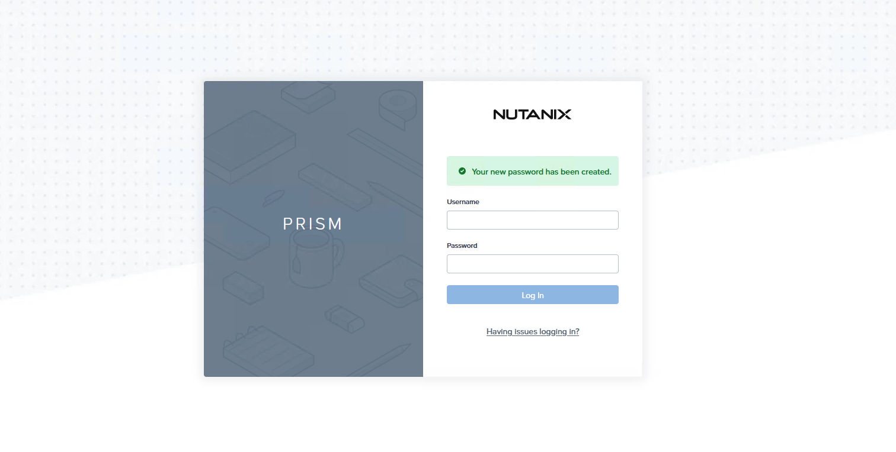

After the password is changed continue with the EULA

 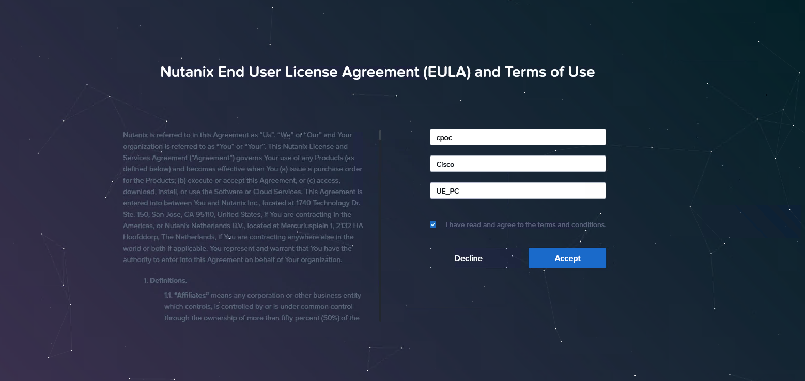

Keep Pulse by default and click Continue

 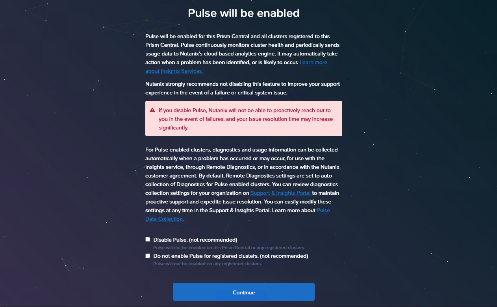

At the top select Infrastructure from the drop-down, then click on Prism Central Settings, select Prism Central Management and click edit

Cluster name = PC-VIP-UE
Virtual IP = 198.18.137.5
Click Save Changes

 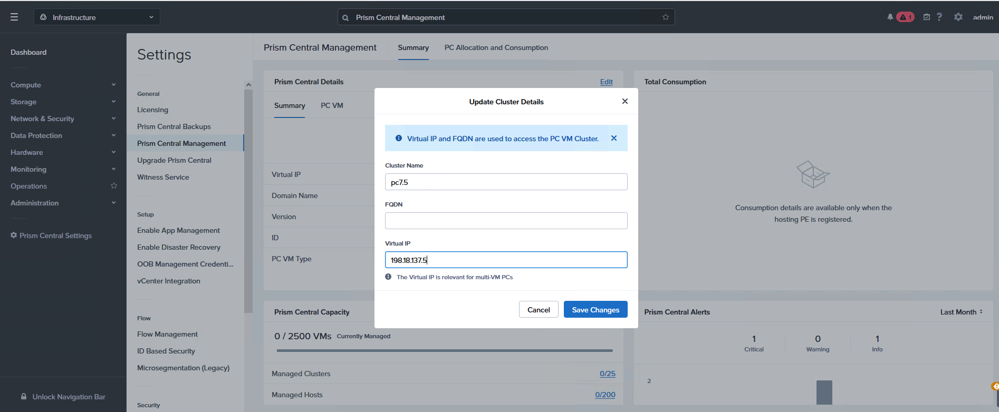

From the drop-down menu select Admin Center then click Marketplace and click Enable Marketplace

 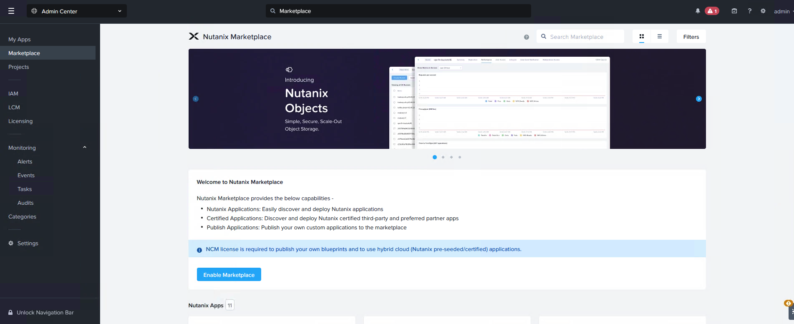

Once the Marketplace has been enabled, click “Get” on Foundation Central then click Deploy

 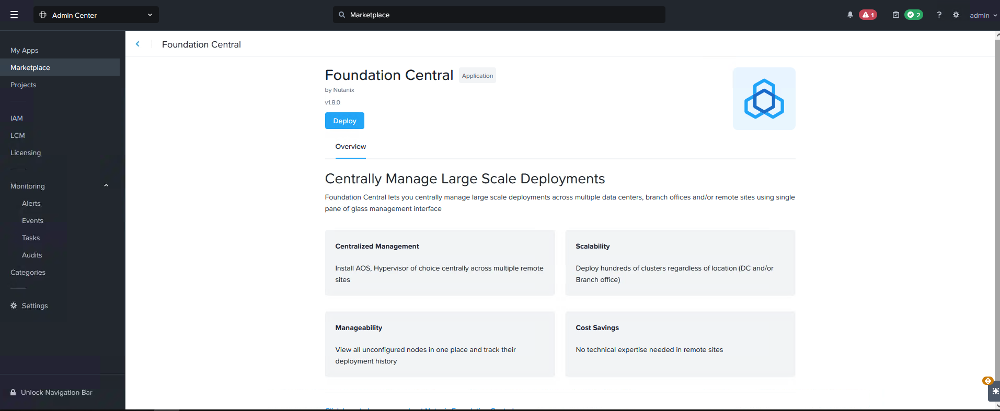

While the Foundation Central app is being deployed on Prism Central, return to the Prism Element main dashboard, and confirm, then click “Register or create a new” and click connect

 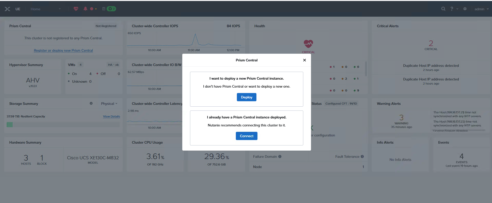

On the Prism Central configuration add

Prism Central IP/FQDN = 198.18.137.5
Username = admin
Password = C1sco12345!
Click Connect

 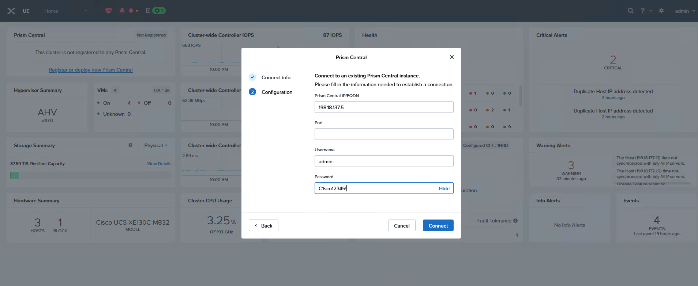

The UE cluster is now registered with and connected to the new Prism Central (PC-7.5.1.1)

 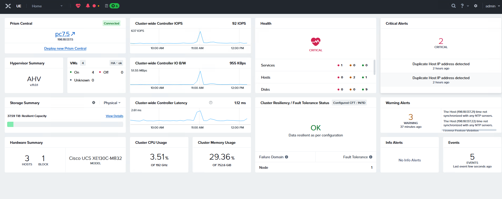

## Prism Central Intersight Device Connector Information

An exciting new feature has been released for a Cisco Intersight Device Connector to be installed in Nutanix Prism
Central via the Marketplace, enabling inventory and monitoring information from Nutanix Prism Central and the
clusters it manages to be shown in Cisco Intersight. To enable the feature, specific software requirements must be
met as detailed here:
• Nutanix Prism Central must be deployed on a Nutanix AOS cluster, not a non-Nutanix cluster
• Nutanix Prism Central 7.3 or later is required to retrieve VM and GPU inventory
• The AOS cluster hosting Prism Central 7.3 must run AOS 6.10 or later
• Prism Central Marketplace must be enabled
• The clusters managed by Prism Central can use AHV or ESXi as their hypervisors
• Prism Central to Cisco Intersight connectivity
• Proxy settings are configured in the Device Connector settings, not from Prism Central
• Nutanix LCM 3.1 is required to perform upgrades of the Device Connector
• If using the Cisco Intersight appliance, it must be upgraded to version 1.1.2-0 or later
• The Prism Central user deploying the connector must have admin or super admin permissions
• Cisco Intersight account(s) with appropriate roles defined to claim Prism Central and view the inventory and
monitoring data

Once Foundation central is deployed, scrolll down and search for Cisco Intersight Device Connector

 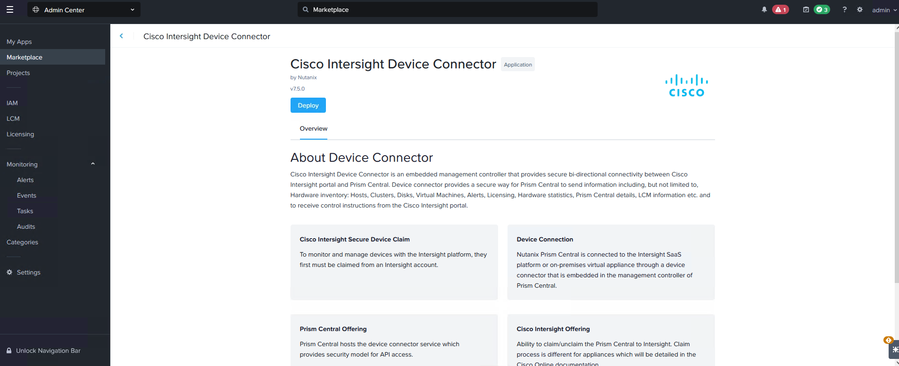

Open the Cisco Intersight Device Connector app from the My Apps area. A new web browser window will open with the Device ID and Claim Code. Copy the Device ID and Claim code to claim this Prism Central instance in Cisco Intersight.

 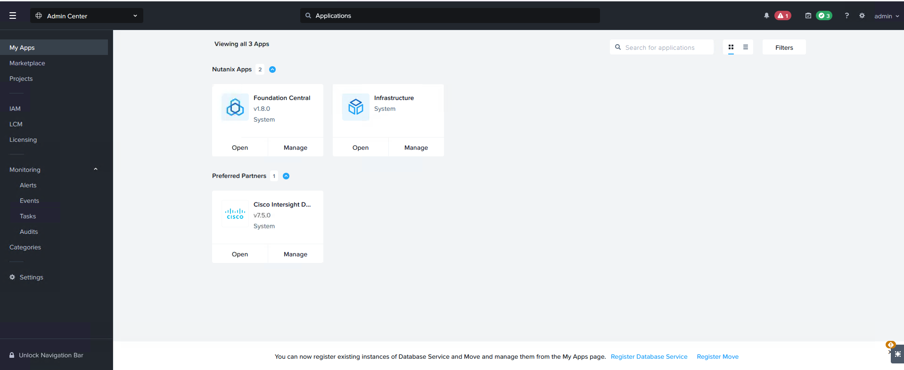
 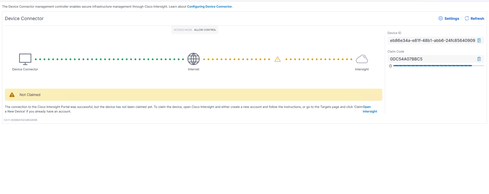

Return to Intersight auto login to access Intersight again

 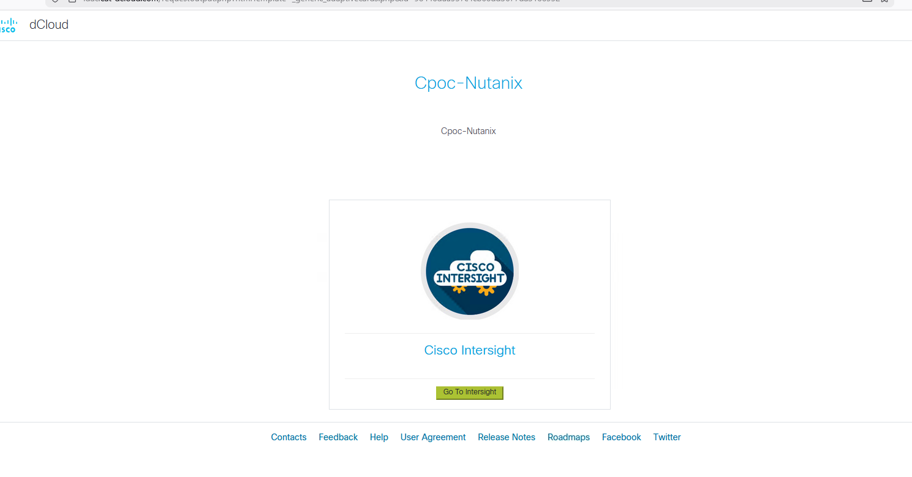

On Intersight on the left pane, scroll down to System, Targets and claim a new Target

 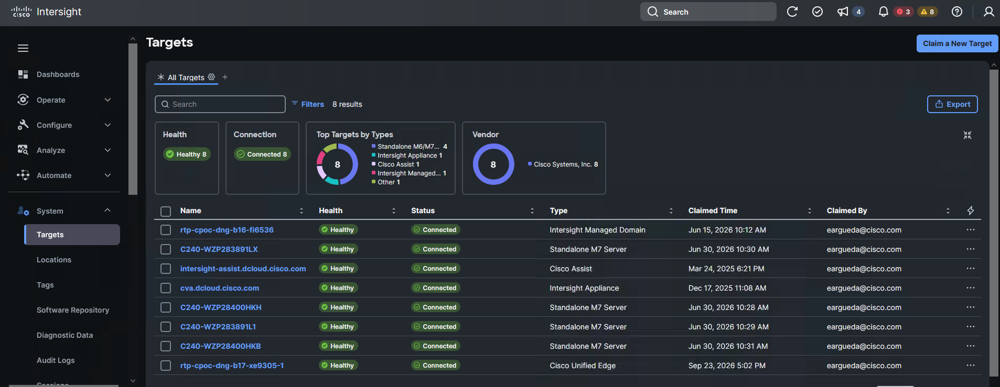

Scrolldown and look for Nutanix Prism Central and click start

 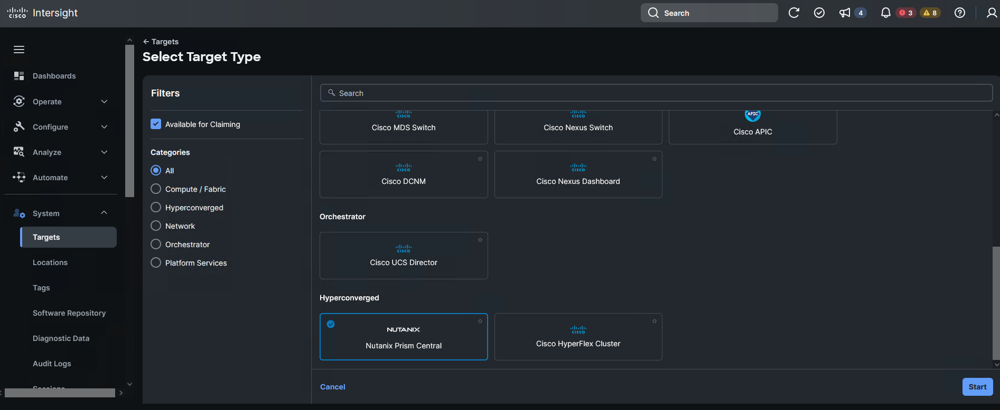

Return to the tab where the device connector are, then copy and paste into Intersight and click Claim

 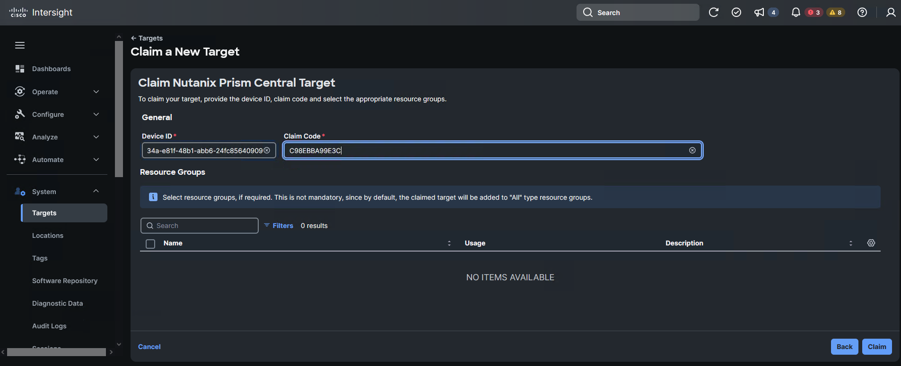

Once the connection is done, the target will display on the Targets list

 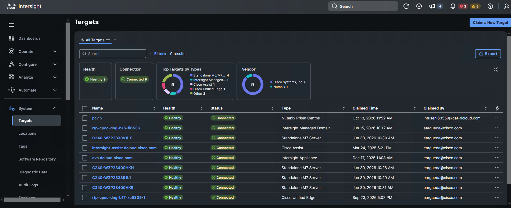

