# Scenario 6 View and Monitor Nutanix Clusters in Cisco Intersight

A new menu item for Nutanix Clusters will appear on the left, which will contain links to the Prism Central
instance that was just claimed and all the clusters managed by that Prism Central instance.

    If you don't see the new Nutanix Cluster, just need to refresh the browser

 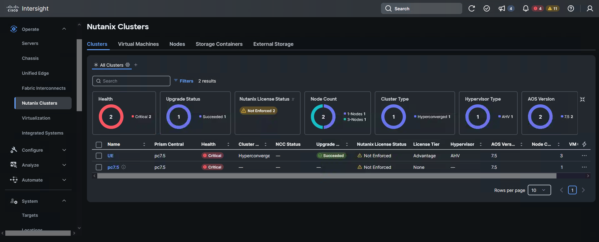

Virtual Machine information can be viewed, including which cluster and node they operate on, virtual CPU and RAM information, and OS information if the VM guest tools are installed.

 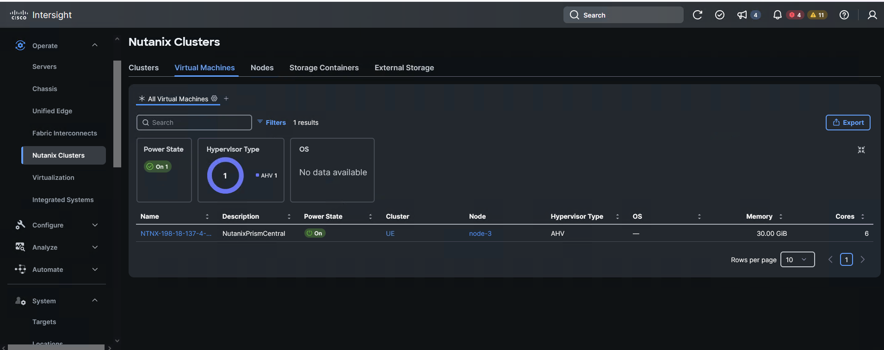
 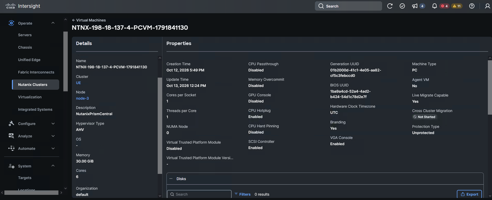

Return to Prism central 198.18.137.2, from the top drop down, select settings, then click on Image configuration

 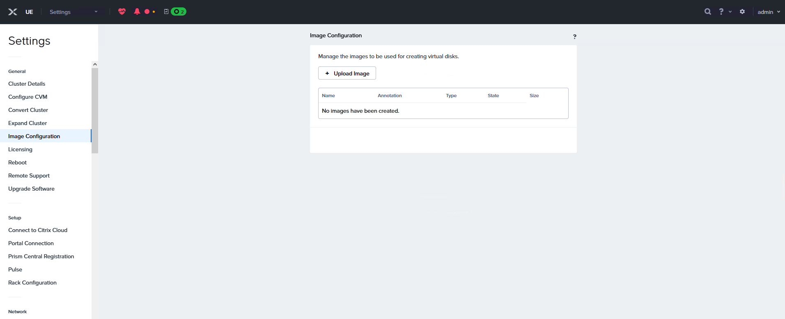

Before to continue with the Image configuration, we need to get the Ubuntu OS, return to the Cisco IMM Transition tool 198.18.129.100 to get the Ubuntu image

 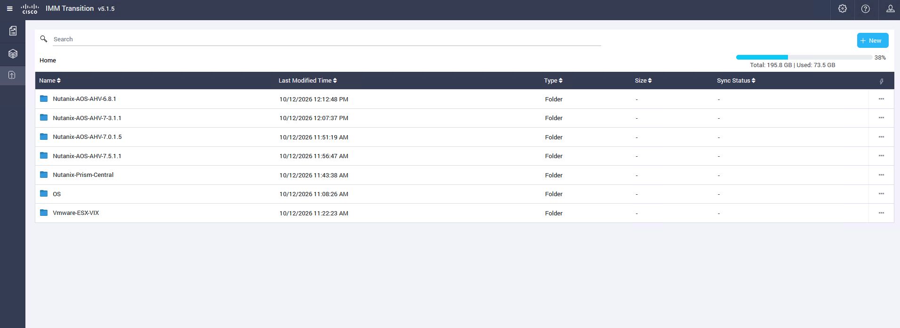

Click on OS and download the image of Ubuntu OS

 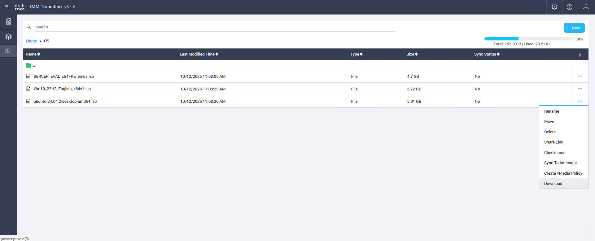

Now return to Prism central Image configuration

In this case we are going to use Ubuntu as an example

Name = Ubuntu ISO

Image Type = ISO
Storage Container = DS-1
Image Source

Upload File > Click “Browse…”, from the Downloads folder select Ubuntu ISO
Click Save

 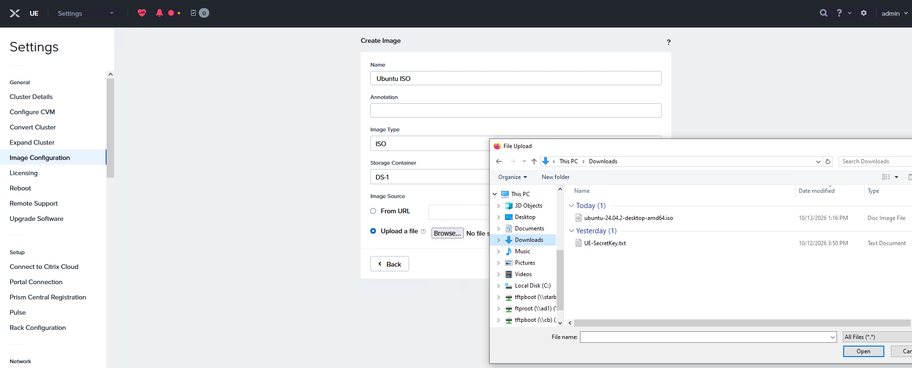

Then click the drop-down menu on the top left and select “VM”

 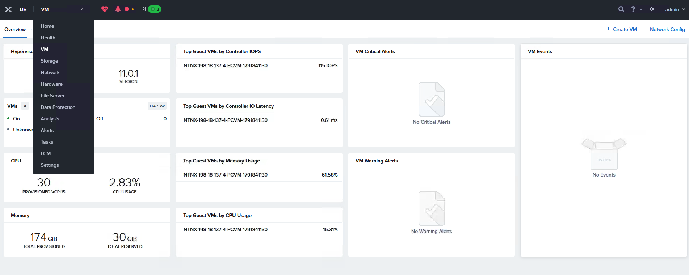

In the VM dashboard click “+ Create VM” on the top right

 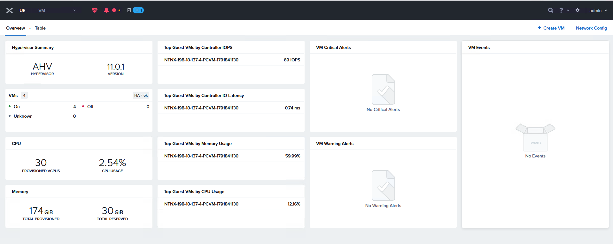

Let’s fill in the new VM information

Name = Ubuntu VM

vCPU(s)= 2
Memory = 4
Select the existing CD-ROm and click on the pen and change the
Operation = clone from image service
Image Ubuntu ISO
CLick Update

+ Add New Disk

Type DIsk
Operation =  Allocate on storage container
Storage container = DS-1
Logical Size = 20G
Click Add

Network Adapters (NIC) 
+ Add New NIC 
Subnet Name = VMNetwork 
Click Add
Click Save

 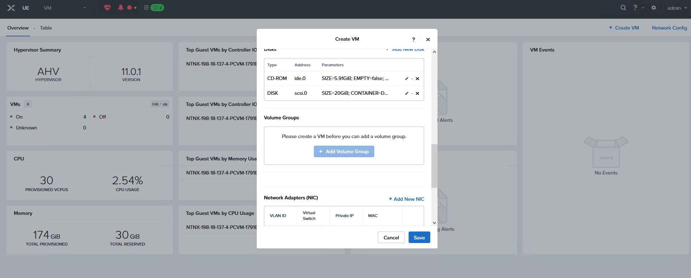

Then Click Table at the top left, next to overview and Right-click the Ubuntu VM and select Power On

 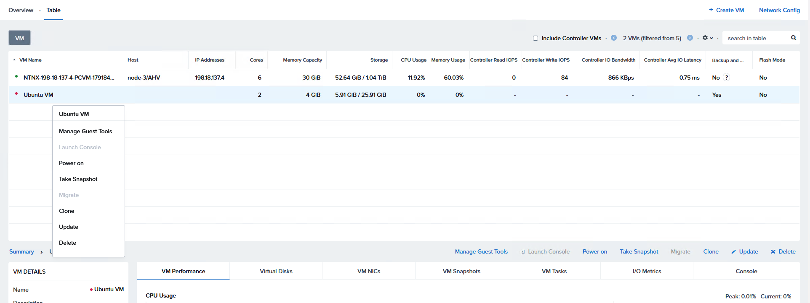

Right-click the VM again and select Launch Console

 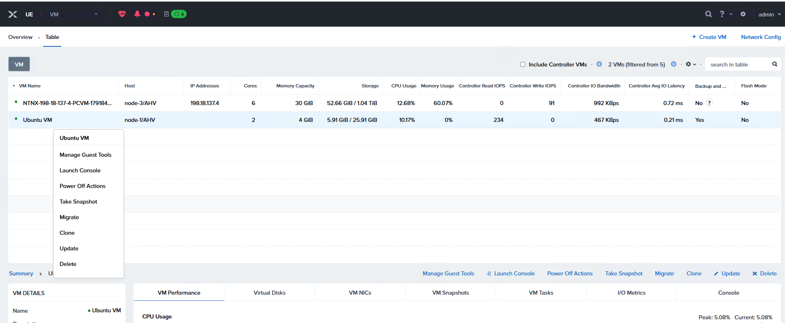

On the VM console, close the Installation window and open a Firefox browser and point to “cisco.com” to test VM usability and connectivity to the Internet.

 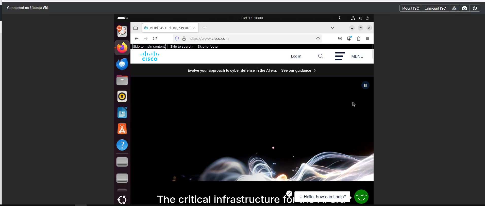

## Cluster Expansion

Expansions of Nutanix clusters running on Cisco Unified Edge hardware are not allowed with the initial software release. Cluster expansions will be supported with a future software release.
